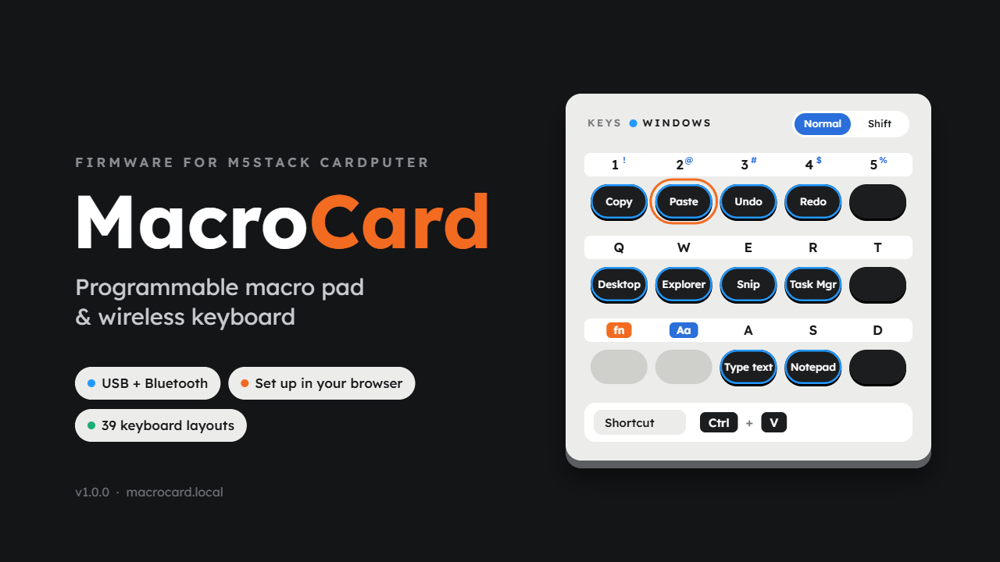

# MacroCard



Programmable macro pad firmware for the M5Stack Cardputer v1.1 (StampS3A).
It works as a USB keyboard and as a Bluetooth LE keyboard. Keys are
programmed from a web page in your browser: `http://macrocard.local`.

Tested on the Cardputer v1.1. The Cardputer ADV is detected by the same code
but has not been tested.

## Install

**With M5Burner:** search for *MacroCard*, pick the Cardputer, Burn.
**Or with esptool:** flash `macrocard-v<version>-cardputer.bin` at `0x0`:

```
esptool --chip esp32s3 write-flash 0x0 macrocard-v1.0.0-cardputer.bin
```

To flash, put the Cardputer in download mode first: with USB plugged in,
switch the power off, hold **G0**, switch the power on, release G0 (the
screen stays dark). After that, updates can be installed over Wi-Fi.

Installing over an older MacroCard keeps the macros on the SD card; Wi-Fi
settings and the access code are created again.

## Programming keys (web)

Wi-Fi runs in the background next to USB and Bluetooth, so the web page is
reachable whichever way the pad is connected to the computer.

1. On the Cardputer press **Fn + W** to open the Wi-Fi menu. It shows the
   current network and lets you turn Wi-Fi on/off or choose another network
   (move with `;` / `.`, Enter to select, type the password, Enter; **R**
   rescans the list). Fn + ` or Fn + W closes the menu.
2. When the footer shows `macrocard.local`, open **http://macrocard.local**
   on the computer (or the IP address shown on the Cardputer). The first time
   the page asks for the pad's **6-digit access code** (see
   [Access code](#access-code) below); the browser remembers it.
3. Click a key on the picture of the Cardputer keyboard → **+ Shortcut** →
   press the combination on your computer keyboard (e.g. Ctrl+Shift+P).
   You can also add text, media keys and delays. **+ Profile** adds a profile,
   **Duplicate** copies one.
4. **Save** (or Ctrl+S). The change is active immediately. **Test (3 s)**
   sends the macro to the computer (over USB or Bluetooth) without saving.

Wi-Fi stays on (and reconnects after a restart) until you turn it off in
the Fn + W menu. The header shows `WiFi` while the web page is reachable.

### Access code

Anyone on your Wi-Fi network can open `http://macrocard.local`. To stop
them from changing your macros or making the pad type on your computer, the
page only works with the pad's **6-digit access code**.

- **Where to find it:** on the Cardputer's screen. The footer shows
  `code 123456  macrocard.local` while Wi-Fi is connected, and the
  **Fn + W** menu has an `Access code: 123456` line.
- **First visit:** the page opens a box asking for the code. Type it and
  press Enter. The browser remembers it, so you are asked again only in a
  new browser or after clearing site data.
- **What it protects:** loading and saving macros, the **Test** button and
  **Firmware update**. Anything else the page shows (version, free memory,
  layout list) does not reveal or change your macros.
- **Wrong codes:** after 5 wrong codes the pad refuses every code for one
  minute, so the code cannot be guessed by trying them all.
- **How long it lasts:** the code is random, made once per device and stored
  on the pad. It stays the same across restarts and Wi-Fi firmware updates.
  A full reinstall over USB (M5Burner or esptool) erases it and the pad
  makes a new one.
- **Command line:** send it in the `X-Code` header, e.g.
  `curl -H "X-Code: 123456" http://macrocard.local/api/config`.

The code keeps out other people on your network. It is not encryption: the
page uses plain HTTP, so only use the pad on a network you trust.

**Sharing profiles:** **Export** (top bar) downloads all profiles, **Export
profile** only the selected one. **Import** adds the profiles from such a file
(yours or someone else's) next to your current ones; nothing is replaced.
You can also drop a file onto the page.

**Keyboard profile (built in):** every key types what is printed on it
(Shift included), so the Cardputer doubles as a wireless keyboard. Ctrl, Alt
and Opt (= Windows key) work as modifiers, Ctrl + Opt + `;` `,` `.` `/` are
the arrow keys, Fn + `` ` `` is Esc and Fn + del is Delete; held keys repeat.
All other Fn shortcuts (profile switching, Wi-Fi menu…) work as in every
profile. It cannot be edited or deleted and is not part of Import/Export.

Windows does not pass Win-key shortcuts (Win+D etc.) to the browser: after
recording, click the **Win** button, or type `win+d` in the box next to it.

Settings are saved to the SD card (`/macropad.json`, previous version in
`/macropad.bak`) when a card is inserted, otherwise to internal flash.

The Cardputer only sees **2.4 GHz** Wi-Fi networks.

## Typing text: computer, keyboard layout, Unicode

A USB/Bluetooth keyboard cannot send letters, only key *positions*; the
computer turns positions into letters with its own keyboard layout. So for
**Type text** steps and **Keyboard profiles** the pad has to know the
computer's layout (shortcuts like Ctrl+C or Win+D work everywhere).

- **Keyboard layout** (default *English (US)*): 39 layouts generated from
  xkeyboard-config, the database Linux uses (Windows layouts of the same
  name match it): English US/US-international/UK, Turkish Q/F, German, Swiss,
  French, Belgian, Canadian French, Spanish, Latin American, Italian,
  Portuguese, Brazilian, Dutch, Swedish, Finnish, Danish, Norwegian,
  Icelandic, Polish, Czech, Slovak, Hungarian, Croatian, Slovenian, Romanian,
  Estonian, Latvian, Lithuanian, Greek, Russian, Ukrainian, Bulgarian,
  Hebrew, Arabic, Japanese (JIS). Accented letters that need a dead key
  (é, ñ, ê…) are typed as accent + letter.
- **Computer**: Windows, macOS or Linux. On macOS AltGr is Option, and the
  Mac version of a layout is used where one exists.
- **Unicode input** (optional): characters the layout does not have (other
  alphabets, emoji, Japanese…) are typed with the OS's own Unicode input:
  - Linux: Ctrl+Shift+U, nothing to set up (GTK/Qt apps with IBus).
  - macOS: add *Unicode Hex Input* in Input Sources and use it (pick English (US)).
  - Windows: one-time `reg add "HKCU\Control Panel\Input Method" /v EnableHexNumpad /t REG_SZ /d 1`, then sign out/in.
- **Fn + L** on the pad changes computer and layout, e.g. when you move it
  to another computer.

Limits: Japanese/Chinese input methods (IME) cannot be driven by key
positions, use Unicode input for those characters. Without Unicode input,
characters that are not on the chosen layout are skipped.

Tables: `tools/gen_layouts.py` (generator) and `tools/test_layouts.py`
(checks against known Windows layouts); output is `src/layouts.generated.cpp`.

## Keys on the device

| Key | Action |
|---|---|
| Any key | Runs the macro assigned to it |
| Shift + key | Second layer (keys like `"Q"`, `"!"`) |
| Fn + `,` / Fn + `/` | Previous / next profile (Fn + `[` / `]` too) |
| Fn + `;` / Fn + `.` | Scroll the list |
| Fn + 1..9 | Jump to profile N |
| Fn + W | Wi-Fi menu: on/off, choose network (`macrocard.local`) |
| Fn + L | Computer (Windows/macOS/Linux) and keyboard layout |
| Fn + M | Output: AUTO → USB → BT |
| Fn + R | Reload `macropad.json` |
| Fn + B | Screen brightness |
| Fn + H | Help |

In AUTO, USB is used when connected, otherwise Bluetooth. Profile, output
mode, brightness and Wi-Fi on/off are remembered.

## Updating firmware

**Over Wi-Fi (normal way):** on the web page click **Firmware update** in
the top bar and pick the new firmware: `.pio/build/cardputer/firmware.bin`
after `pio run -e cardputer` (the app part only; the merged release file is
for flashing at 0x0). The pad restarts by itself. From the command line,
with the code from the pad's screen:

```
curl -H "X-Code: 123456" -F "firmware=@.pio/build/cardputer/firmware.bin" http://macrocard.local/api/update
```

Firmware updates need the [access code](#access-code) like any other change.

**Over USB (first install or recovery):** use PlatformIO from PowerShell or
VS Code (ESP-IDF tools do not work from Git Bash). With USB plugged in,
switch the power off, hold **G0**, switch the power on, release G0 (screen
stays dark), then `pio run -e cardputer -t upload`.

The firmware deliberately exposes **no serial (COM) port**: programs that
scan COM ports (slicers etc.) can reset serial devices. For debugging,
`pio run -e diag -t upload` keeps USB as a log console (no USB keyboard in
that build, Bluetooth + Wi-Fi only) and can be re-flashed without G0.

## Making a release (M5Burner / GitHub)

1. Bump `MACROCARD_VERSION` in `src/version.h`.
2. `pio run -e cardputer`
3. `python tools/make_release.py` → `release/macrocard-v<version>-cardputer.bin`
   (bootloader + partition table + app merged, flash at 0x0; the script checks
   every part was placed correctly).
4. M5Burner → log in → **USER CUSTOM → Publish**: name *MacroCard*, version,
   device *Cardputer*, the GitHub link, the `.bin`, a cover image.

## Memory

USB, Bluetooth and Wi-Fi together leave about 38 KB of free RAM (about
14 KB at the lowest point while saving from the web page). That is why the
screen is drawn in strips, the web page is stored gzipped, the configuration
is sent as compact JSON, and the unused speaker and microphone are not
started. Keep this in mind before adding features.

## macropad.json

The web page edits this file for you. Format, for reference:

```json
{
  "device_name": "MacroCard",
  "layout": "us",
  "os": "windows",
  "unicode": false,
  "typing_delay_ms": 8,
  "profiles": [
    {
      "name": "Example",
      "color": "#2299ff",
      "keys": {
        "1": "ctrl+c",
        "2": { "label": "Paste", "do": "ctrl+v" },
        "m": { "label": "Mute", "do": { "media": "mute" } },
        "v": { "label": "Vol +", "do": { "media": "volup" }, "repeat": true },
        "s": { "label": "Signature", "do": { "text": "Best regards,\nName" } },
        "n": { "label": "Notepad", "do": ["win+r", { "delay": 500 }, { "text": "notepad\n" }] }
      }
    }
  ]
}
```

- `device_name`: name shown over USB and Bluetooth (applies after restart).
- `layout`, `os`, `unicode`: see *Typing text* above (layout ids: `us`, `us-intl`, `gb`, `tr`, `tr-f`, `de`, `fr`, ... as listed by `/api/layouts`).
- `typing_delay_ms`: delay between key presses (Bluetooth uses at least 12 ms).
- `type`: `"keyboard"` makes it a keyboard profile (see above).
- `keys`: the Cardputer key: `"1"`, `"q"`, `"-"`, `"["`, or for the Shift
  layer `"Q"`, `"!"`, `"{"`. Special keys: `"tab"`, `"enter"`, `"del"`, `"space"`.

| Step | Example | Meaning |
|---|---|---|
| Shortcut | `"ctrl+shift+p"` | Press and release the keys |
| Text | `{ "text": "hello\n" }` | Type text (`\n` = Enter) |
| Delay | `{ "delay": 300 }` | Milliseconds (max 10000) |
| Media | `{ "media": "volup" }` | Volume / media key |

**Modifiers:** `ctrl`, `shift`, `alt`, `win` (`cmd`, `gui`), `altgr`,
`rctrl`, `rshift`, `rgui`.
**Key names:** `a`–`z`, `0`–`9`, `f1`–`f24`, `enter`, `esc`, `tab`, `space`,
`backspace`, `delete`, `insert`, `home`, `end`, `pageup`, `pagedown`, `up`,
`down`, `left`, `right`, `printscreen`, `capslock`, `menu`, `kp0`–`kp9`,
`kp_dot`, `kp_enter`, `kp_plus`, `kp_minus`, `kp_star`, `kp_slash`, raw `0x68`.
**Media:** `volup`, `voldown`, `mute`, `play`, `next`, `prev`, `stop`,
`bright_up`, `bright_down`, `calculator`, `browser`, `mail`, `mycomputer`.

Tip: `f13`–`f24` are unused by default in almost every program, so they are
conflict-free targets for AutoHotkey, OBS or app shortcuts.

## Code layout

| File | Purpose |
|---|---|
| `src/main.cpp` | Key scanning, Fn shortcuts, Wi-Fi dialogs |
| `src/web.cpp`, `web/index.html` | Background Wi-Fi, web server, OTA update, configurator page |
| `src/storage.cpp` | SD card / internal flash storage |
| `src/macros.cpp` | JSON parsing and macro execution |
| `src/keycodes.cpp` | Key names, media codes, US/TR text tables |
| `src/hid_output.cpp`, `src/usb_hid.cpp`, `src/ble_hid.cpp` | USB / Bluetooth HID |
| `src/ui.cpp` | Screen |
| `tools/embed_config.py` | Embeds `sd/macropad.json` and the gzipped `web/index.html` into the firmware |
| `lib/BLE` | Patched copy of the core BLE library (see `lib/BLE/PATCHED.md`) |
